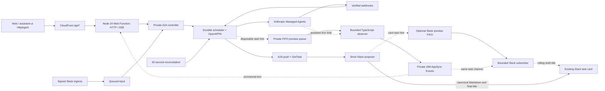

# Managed Agent Web + Slack

This is a reference implementation and is not an official Anthropic, Slack, AWS,
or assistant-ui project.

A serverless reference application for continuing the same Anthropic Managed Agent conversation from Web and Slack. The application owns authorized threads and A2A Tasks; the private controller owns provider sessions, execution and native OpenAPPA tool policy. Anthropic retains the canonical transcript. Aurora DSQL holds identity, routing, idempotency and projection metadata only.



The durable P0 path completes without provider SSE or preview transport. OpenAPPA can automatically allow/deny or require review of an exact tool call. Web and Slack submit the first authorized human ruling; a fresh native OpenAPPA remedy must authorize it before CMA confirmation.

Optional Slack previews show a rolling `Draft: …` title on an existing task card. Canonical Markdown remains authoritative. The same CMA reader feeds independent Web and Slack AppSync subscribers; drafts stay in memory. `SLACK_PREVIEW_ENABLED=false` is the default and enabling it also requires `PREVIEW_ENABLED=true`. See the [Phase 6 rollout note](docs/phase-6-rollout.md) for limits and remaining live acceptance.

## Run locally

Prerequisites: Node 24, Python 3.14 through uv, Docker Compose, and the pinned Rust 1.99.0 toolchain. Install Chromium explicitly for browser tests.

```bash
npm ci
uv sync --directory backend --locked
npx playwright install chromium
npm run dev
```

Use the printed Web URL and local access token `e2e-access-token`. Ctrl-C cleans up this foreground stack. Local mode uses isolated PostgreSQL, fake CMA and recorded Slack APIs; it never loads `.env` or live credentials. See [local development](docs/local-development.md) for isolation and review fixtures.

## Check and build

```bash
npm run check             # native policy, lint, format, types, unit/contract tests
npm run e2e               # PostgreSQL + semantic browser tests
npm run e2e:production    # exported Web smoke
npm run build             # Web + Lambda artifacts
npm run terraform:validate
npm run secrets:check     # requires Gitleaks 8.24.3
```

`npm run verify:full` composes the local checks, both browser layers, Lambda build and Terraform tests. [Testing](docs/testing.md) distinguishes fake-provider evidence from live acceptance and [known limitations](docs/known-limitations.md).

## Deploy deliberately

Configure untracked `.env` from `.env.example`, verify the AWS account, and use the existing deployment's `TF_STATE_BUCKET`. Region defaults to `us-west-2`.

```bash
npm run cma:plan           # provider definition preview
npm run deploy:plan        # account checks + saved Terraform plan; no apply
npm run deploy            # explicit real deployment
```

Phase 5 previews default to disabled. Read the [public upgrade checkpoints and rollback procedure](docs/upgrading.md) before applying this branch; retiring Web resources requires a saved target-account plan and explicit approval. Use `--application-only` to avoid unrelated CMA, secret synchronization and database operations.

Review [operations](docs/operations.md), [Managed Agent setup](docs/managed-agent-setup.md), and [Slack setup](docs/slack-setup.md) first. Definitions and genuine lock state live in `cma/`; deployments pin the exact agent version. Normal deployment never force/prunes CMA resources. Secrets and generated deployment outputs stay outside Git.

See [architecture](docs/architecture.md), [contributing](CONTRIBUTING.md), and the [DSQL runbook](docs/dsql.md). Optional real-provider testing is API-only: `RUN_LIVE_E2E=1 npm run test:live`; it requires a configured developer sandbox and performs read-only preflight before sending messages.

Report vulnerabilities privately using the process in [SECURITY.md](SECURITY.md).
Do not include credentials or deployment details in public issues or pull requests.
